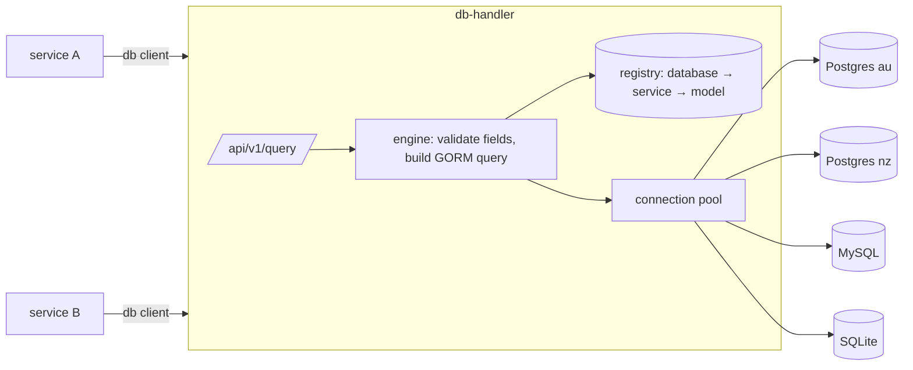

# go-backend-db-handler

A service that owns database access for the `go-backend-*` family. Other services send it a query description over HTTP ([go-backend-db](https://github.com/ahmedbaig/go-backend-db) has the types and a typed client); the handler checks it against the model, runs it with [GORM](https://gorm.io) on the right connection and returns JSON. Callers never know which database engine, host or instance sits behind a name.



## Fully generated models

You don't write model code. `db-gen` connects to every database in the config, reads its tables and writes:

- `models/<database>/*.gen.go`: one GORM struct per table (via `gorm.io/gen`)
- `models/<database>/database_gen.go`: the logical database name
- `models/registry_gen.go`: registers every table as a service (`database.table`)

```sh
CONFIG_DIR=./configs go run ./cmd/db-gen            # all databases
CONFIG_DIR=./configs go run ./cmd/db-gen -database shop
go run ./cmd/db-gen -types-only                     # registry + types from existing models
```

It also writes the shared **types module** (`types/`, module `github.com/ahmedbaig/go-backend-db-handler/types`): plain structs, field and relation name constants and a typed service per table, with no GORM dependency. Services import that instead of re-declaring tables. Release it with a `types/vX.Y.Z` tag.

Rebuild the service and the new tables are live: no handlers, routes or SQL to add. Handwritten model packages (like `models/demo`) are picked up too, as long as each struct has a `TableName()` method and the package has a `Database` constant.

## API

| Route | Body | Returns |
|---|---|---|
| `POST /api/v1/query` | `{database, instance?, service, method, params}` | `{data}` or `{count}` |
| `POST /api/v1/transaction` | `{database, instance?, queries: [...]}` | `{results: [...]}`, all or nothing |
| `POST /api/v1/{database}/{service}/{method}?instance=` | `params` | same as `/query` |
| `GET /api/v1/capabilities` | | methods, operators, every database, service, field and relation |
| `GET /healthp`, `/healthz`, `/readyz`, `/metrics` | | health (one probe per connection) and Prometheus |

Methods: `findOne`, `findFirst`, `findMany`, `count`, `create`, `createMany`, `update`, `updateMany`, `upsert`, `delete`, `deleteMany`. Params: `where`, `select`, `include` (relations), `orderBy`, `take`, `skip`, `data`, `create`, `conflict`. See the go-backend-db README for the filter format.

```sh
curl -s localhost:8090/api/v1/demo/posts/findMany -H "X-Api-Key: $DB_HANDLER_API_KEY" \
  -d '{"where":{"published":true},"orderBy":[{"field":"id","direction":"desc"}],"take":10,"include":["author"]}'
```

### gRPC

The same operations are served over gRPC on `grpcPort` (default 9090, `0` turns it off), using `DBHandlerService` from [go-backend-proto](https://github.com/ahmedbaig/go-backend-proto). `apiKeys` are accepted as `authorization: Bearer <key>`. Request and correlation IDs, the calling user and errors cross the hop intact, and validation is identical to the REST routes. Reflection is on in `localhost` only.

```go
c, conn, err := dbgrpc.Dial("db-handler:9090", grpcx.ClientOptions{ServiceToken: key})
posts := db.NewService[demo.Post](c, "demo", "posts")
```

```sh
grpcurl -plaintext -H "authorization: Bearer $DB_HANDLER_API_KEY" \
  -d '{"database":"demo","service":"posts","method":"count"}' localhost:9090 ahmedbaig.dbhandler.v1.DBHandlerService/Query
```

## Safety rules

- Every field name in `where`, `select`, `orderBy`, `data` and `conflict` must exist on the model (JSON name, Go name or column name). Columns are always quoted by GORM, values are always bound parameters.
- Values are converted to the column's Go type before querying; a wrong type is a 400 naming the field.
- `update`, `updateMany`, `delete`, `deleteMany` and `findOne` refuse an empty `where`.
- `update`, `delete` and `findOne` must match exactly one record (404 for none, 409 for several).
- `findMany` without `take` uses `defaultTake` and logs a warning; `take` above `maxTake` is rejected.
- `contains`/`startsWith`/`endsWith` escape `%` and `_`.
- Unique and foreign key violations become 409; everything else unexpected is a logged 500.
- Optional `X-Api-Key` check; services can be registered read-only.

## Redis and Mongo stores

Besides SQL, the handler owns key-value state in Redis and documents in Mongo. Services reach both through the same API and client, so sessions and analytics never need their own connections.

| Route | |
|---|---|
| `POST /api/v1/kv/{store}/{op}` | Redis: `get` (with `touch` + `ttlMs` for sliding expiry), `mget`, `set` (`ttlMs`, `nx`, `xx`), `del`, `expire`, `ttl`, `incr` (`by`, `ttlMs`), `publish` |
| `POST /api/v1/docs/{store}/{collection}/{op}` | Mongo: `insert`, `find`, `findOne`, `count`, `aggregate`, `update` (`many`, `upsert`), `delete` (`many`) |
| `POST /api/v1/analytics/{store}/track` | store events in `events`, upsert one `daily_active_users` doc per user per day |
| `GET /api/v1/analytics/{store}/dau?from=&to=` | daily active users per day |

- Redis keys and channels get the store's `prefix`. Values are JSON, up to 1 MiB.
- Mongo filters, sorts, projections and pipelines are Mongo extended JSON (`{"$date": ...}`, `{"$oid": ...}`). `$where`, `$function`, `$accumulator`, `$out` and `$merge` are rejected anywhere in the request. Updates must use update operators; update and delete need a filter; `find` defaults to 100 and is capped at `maxLimit`; aggregations get a `$limit` if they have none.
- `collections` on a Mongo store restricts which collections are exposed.
- Each store gets a health probe (`redis:<name>`, `mongo:<name>`) and appears in `/api/v1/capabilities`.

## Configuration

Three JSON files in `CONFIG_DIR` (or `DB_HANDLER_SECRET`, `DB_HANDLER_DB_SECRET`, `DB_HANDLER_LOGGER_SECRET` env vars), see `configs/*.sample`:

- `db-handler.json`: port, `grpcPort`, environment, request timeout, `defaultTake`, `maxTake`, `apiKeys`
- `db-handler-db.json`: `connections` (SQL), `redis` (name, addr or url, password, db, tls, prefix, poolSize, timeout) and `mongo` (name, uri, database, collections, maxLimit, timeout). SQL connections: Each has a logical `database` name, optional `instance`, `driver` (`postgres`, `mysql`, `sqlserver`, `sqlite`), either `dsn` or host/port/user/password/name/params, and pool settings. Several connections can share a database name with different instances; `default: true` picks the one used when a query names no instance.
- `db-handler-logger.json`: see go-backend-logging

## Run

```sh
mkdir -p var && cp configs/db-handler.json.sample var/db-handler.json   # edit, then
CONFIG_DIR=./var go run ./cmd/db-handler
go test ./...
```

## License

MIT
